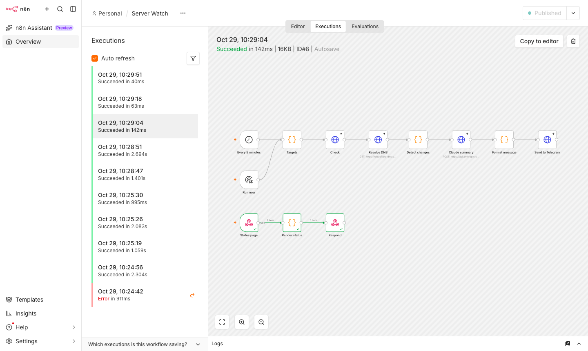
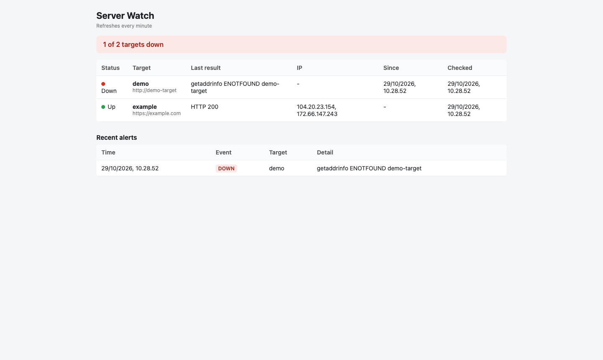

# n8n Server Watch

An n8n workflow that watches web servers and tells you when something changes:

- **DOWN**: the site stops answering or returns an error status (4xx/5xx).
- **RECOVERED**: it comes back.
- **IP_CHANGED**: the domain's DNS A record points somewhere new.

Alerts are sent once per change, not on every check. When an Anthropic API key is set, Claude adds a short summary in Indonesian with the likely cause and the first thing to check. The message goes to Telegram.

It started from a real incident: a production server's IP changed and nobody was notified until users complained.



```
Every 5 minutes ─┐
Run now ─────────┴─> Targets ─> Check (HTTP) ─> Resolve DNS (DoH) ─> Detect changes ─> Claude summary ─> Format message ─> Telegram
Status page (GET) ─> Render status ─> Respond (HTML)
```

The previous state of each target is kept in the workflow's static data, so the workflow only continues past **Detect changes** when there is something new to report.

## Status page

The same workflow serves a status page at `http://localhost:5678/webhook/server-watch` once it is activated. It shows each target's current state, its IPs, when it last changed, and the latest 50 alerts, and refreshes every minute.



Set `STATUS_TOKEN` to require `?token=<value>` before exposing n8n beyond your machine.

## Run it

Requires Docker.

```bash
cp .env.example .env          # set WATCH_TARGETS, and optionally the Claude and Telegram keys
docker compose up -d
docker compose exec n8n n8n import:workflow --input=/workflows/server-watch.json
```

Open http://localhost:5678, create the owner account, open **Server Watch** and activate it.

To try an outage, watch the bundled demo site and stop it:

```bash
docker compose stop demo-target    # next run sends a DOWN alert
docker compose start demo-target   # next run sends a RECOVERED alert
```

Static data is only saved for scheduled (active) runs, so test state changes with the workflow activated rather than with **Test workflow**.

## Configuration

| Variable | Purpose |
| --- | --- |
| `WATCH_TARGETS` | Comma-separated `name\|url` pairs, e.g. `hris\|https://hris.example.com,shop\|https://shop.example.com` |
| `ANTHROPIC_API_KEY` | Optional. Enables the Claude summary. Without it, the raw alert is sent |
| `ANTHROPIC_MODEL` | Defaults to `claude-haiku-5-5` |
| `TELEGRAM_BOT_TOKEN`, `TELEGRAM_CHAT_ID` | Where alerts go. Create a bot with @BotFather |
| `STATUS_TOKEN` | Optional. Protects the status page |

The Claude and Telegram steps continue on error, so a missing key or a failed call never stops the check itself.

## Tests

The change-detection logic is tested by running the Code node straight from the workflow file:

```bash
npm test
```

## Stack

n8n 2.40, Docker Compose, Cloudflare DNS over HTTPS, Anthropic Messages API, Telegram Bot API.
